# Using the terminal client

The terminal client is a program that runs in a terminal window. It starts its own private Tor,
connects to a node and keeps everything you have - identity, group keys,
subscriptions, what you have read - in one encrypted file, the **vault**.

Prefer a window and a mouse? The [graphical client](https://unseenet.org/graphical/) uses the same vault
and works the same way.

## Install

The easiest way, on **Windows, macOS and Linux**, is a
[portable build](https://unseenet.org/portable/): one folder with the client and Tor inside,
nothing to install, and it runs from a USB stick.

To install it with Python instead, you need Python 3.11 or newer, `git`
and the `tor` program.

=== "Fedora"

    ```bash
    sudo dnf install tor git python3
    ```

=== "Debian / Ubuntu"

    ```bash
    sudo apt install tor git python3-venv
    ```

=== "macOS"

    ```bash
    brew install tor git python
    ```

Then install the terminal client from PyPI with [pipx](https://pipx.pypa.io/),
which keeps it in its own environment (it brings the Unseenet core along):

```bash
pipx install unseenet-tui
unseenet-tui
```

Or, to follow development, from the repository:

```bash
git clone https://github.com/unseenet/unseenet-tui
cd unseenet-tui
python3 -m venv .venv
.venv/bin/pip install -e .
.venv/bin/unseenet-tui
```

You do **not** need to start or configure the system's Tor service.
Unseenet runs its own Tor process with its own settings and ignores
`/etc/tor/torrc`.

## First start

1. **Choose a passphrase.** It encrypts your vault (`unseenet.vault` in the
   current directory). There is no way to recover it if you forget it.
2. **Choose a display name.** This is just a label. Your real identity is a
   key pair that is created for you.
3. **Choose a node.** The client knows the project's nodes and suggests
   the first; with *Also use the other known nodes as backups* (on by
   default) it adds the others too, and reads from them if the first is
   down. Choose *Another node* to enter an address you were given.

The client then subscribes you to the project's groups - `unseenet`
(the project), `unseenet.announce` (release notes), `unseenet.help`
(ask anything), `unseenet.help.news` (what is new, in plain words),
`unseenet.chat` (the project's chat) and `unseenet.test` (say hello) -
and to the demo's feed and site, `unseenet.demo.feed` and
`unseenet.demo.site`, so there is something to read. You can
unsubscribe from them like any other group; they are not added again
(see [the groups you start with](https://unseenet.org/help/#the-groups-you-start-with)).
Stuck? Ask in `unseenet.help` - see [Getting help](https://unseenet.org/help/).

The first connection takes 10-30 seconds while Tor builds its circuits, and
can take a few tries right after Tor starts; the client retries by itself.
After that the connection is reused.

!!! tip "Several vaults"
    Use `--vault` to keep separate vaults, e.g. one per identity or per
    node: `unseenet-tui --vault ~/work.vault`.


On the left are your groups, by hierarchy, with your private posts and
contacts at the top. On the right are the posts in the selected group as
threads, and below them the selected post. The authors show who is who:
`Sonia √` is a contact you named yourself, `Mikkel~` followed by four
letters someone you have not: the name they chose and the start of their
key's fingerprint (see [Names](#names)). The
line at the bottom shows the shortcuts that work where you are; everything
else is in the command palette, ++ctrl+p++:

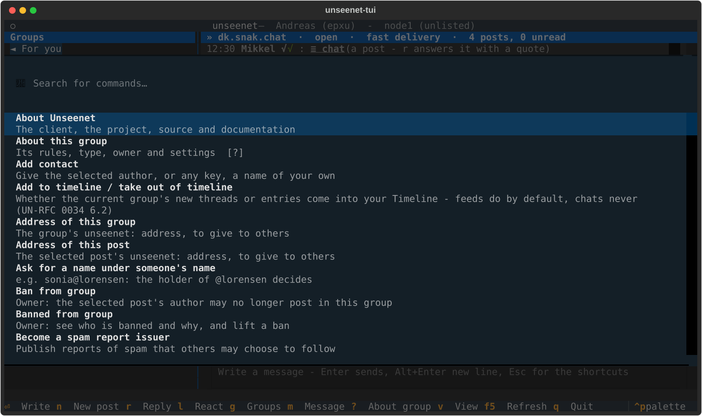

## Keys

| Key | What it does |
|-----|--------------|
| ++g++ | Browse the groups on the node; ++space++, ++enter++ or a click on `[ ]` subscribes or unsubscribes. A click elsewhere on the line, like the cursor, shows what the group is below the list |
| ++enter++ | Read the selected post on the whole screen (or click it a second time; ++f++ does the same) |
| ++n++ | New post in the current group |
| ++r++ | Reply to the selected post |
| ++l++ | React to the selected post, comment or chat line: a number chooses one of the group's emoji; the same again takes it back. Not shown where the group takes no reactions |
| ++ctrl+s++ | Send (in the compose window) |
| ++m++ | Write a private post: type a contact's name or paste a key (pre-filled with the selected post's author); to chat instead: ++ctrl+p++, *Chat with someone* |
| ++c++ | Your contacts: chat, write a private post, rename or remove |
| ++o++ | Your nodes: add, remove, default, who runs them, write to an operator |
| ++k++ | Show your key (share it to get private messages or invitations) |
| `@` | Your names: claim a name such as `@lorensen`, see the ones you hold |
| ++j++ | Join a group by ID, or open an `unseenet:` address of a group, a post or a person |
| ++f5++ | Refresh (also happens every 30 seconds) |
| ++q++ | Quit |
| ++s++ | Edit your signature |
| ++a++ | Add the selected post's author as a contact |
| ++shift+d++ | Withdraw the selected post (yours, or in a group you own or moderate) |
| ++v++ | Switch between chat and threads for the current group |
| ++question-mark++ | About this group: its charter, type, owner and node |
| `!` | Go to a group the selected post names, such as `!dk.snak` |
| ++f1++ | About Unseenet, with links to the source and these pages |
| ++ctrl+p++ | Command palette: everything above, by name, plus what is used less often, like creating a group or inviting someone to a closed group |

Groups are shown by **hierarchy**, the part of the name before the first
dot, as in the old newsreaders: `dk.snak` and `dk.teknik` sit under `dk.*`,
`comp.lang.python` under `comp.*`. Hierarchies with unread posts are bold.
The same goes for the list of all groups on the node (++g++), where
large hierarchies start folded.

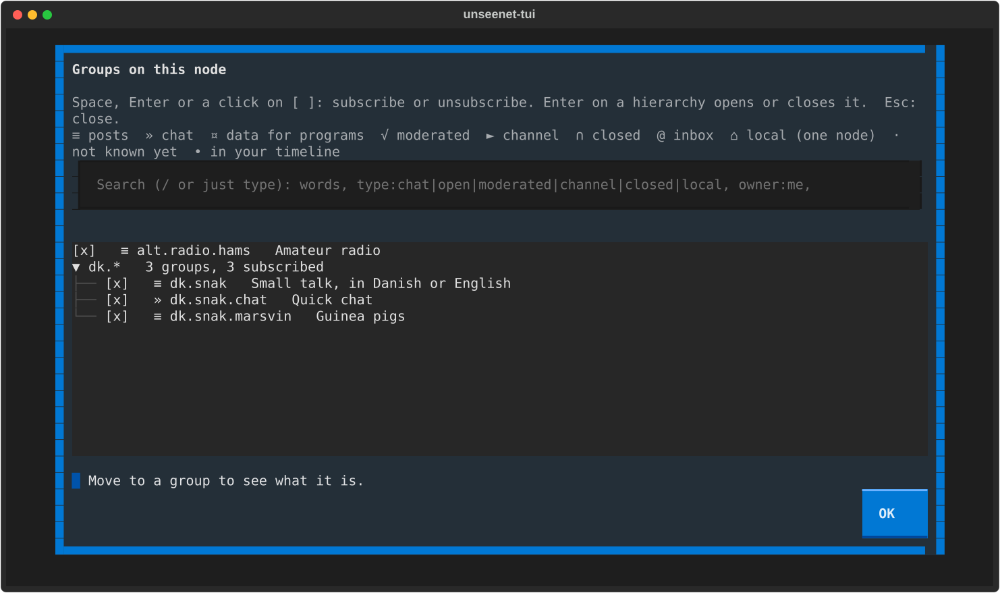

Each group has two icons, in your list and in the list of all groups:
first who may write and read it, then how it is shown.

| Icon | Meaning |
|------|---------|
| `≡` | Posts in threads |
| `»` | Chat |
| `√` | Moderated: posts need a moderator's approval |
| `►` | Channel: only chosen people post |
| `∩` | Closed: members only, end-to-end encrypted |
| `@` | Inbox: anyone writes, only the owner reads |
| `⌂` | Local: on one node only |
| `·` | Not known yet (the group's manifest has not been read) |

Open groups have no first icon, so `≡ dk.snak` is an open group with
threads and `∩ » familie` a closed chat. The icons are from the basic
character set every terminal font has, so they show even in the classic
Windows console.

Unread posts are marked with ●. Posts in closed groups are marked with ∩,
private messages with @.

A post that **replies to one of yours** is marked ◄, and one that **names
you** - one of your certified names, such as `@lorensen` or
`andreas@lorensen` - is marked ♦. **For you**, at the top of your groups,
gathers them from all your groups, newest first, and a group shows how many
it has of each, e.g. `dk.snak (5) ◄1 ♦2`: one reply to you and two posts
naming you. When new ones arrive, the client tells you which kind.
Display names do not count as mentions, since anyone can call themselves
anything. All this is worked out in your client; nothing is sent anywhere.

### Telling the people you mention

If you name someone in a group they do not follow, they would never see
it. So when your post names people by their certified names, the client
also sends each of them a short **mention notice** to their inbox
([UN-RFC 0032](https://unseenet.org/spec/un-rfc-0032/)): who wrote, in which group, and the
subject - never the text. The compose window shows who will be told, and
you can untick it for that post; *Stop telling people you mention* in the
command palette turns it off altogether. At most 5 people are told per
post, a few minutes after it is sent. In a moderated group the notices go
to the moderators with your post, and they are sent when it is approved,
whether you are online then or not. Nobody is told about posts in closed groups or
private posts.

Notices you get show in **For you** with ♦ and the group's name; ++enter++
takes you to the post, or shows the group and asks before subscribing.
Your client first checks that the post exists, that the sender wrote it
and that it really names you; notices from people you ignore are dropped,
and *Stop showing mention notices* turns them off.

## Pointing to another group

Write `!` and a group's name to point someone to it: *you'll probably get
better answers in !dk.snak.marsvin* - as Lemmy writes `!community`. (`#word`
is a tag: your client puts it in the post's tags when you send it.)
References are shown underlined; click one, or press `!` on a post (or in
the full-screen view), to go there: a group you follow opens, and for one you
do not follow, the client shows what it is and asks before subscribing. If
a post names several groups, you choose one; if several groups have the same
name (with different owners), you choose by fingerprint, and you can write
one yourself, as in `!dk.snak@abcd`.

Group names are `a-z`, digits, `+`, `_`, `-` and dots, so `!dk.snak.` at the
end of a sentence means `dk.snak`, while *Hello!*, a picture `![...]` and
`!170` are not groups.

## Link previews

When a post or a private post has a link, the client makes a preview of the
first link that is not quoted before it is sent: the site's domain, its name,
the title and description, and its picture if it has one. It is made over Tor
from the page, once, by you - readers fetch nothing, they only see what is
in the post. You are shown the preview and choose **With preview** or
**Without preview** (Esc); the post is sent either way.

A chat line with a link gets a small preview too, without asking: it is
made while the line is sent (the status line says so) and shown in the chat
as one line, `↳ domain - title`, without the page's picture.

A post with a preview shows it under the text:

```
┌ bt.dk · B.T.
│ Ansat i politiet snød Fleggaard: Nu er han dømt
│ Retten i Sønderborg har idømt en mellemleder i politiet en bødestraf …
└ preview from the poster · 2026-10-30
```

The first line is always the domain of the link itself - the title and the
picture are what the poster says. An address that mixes alphabets, and may
look like another, is marked. The picture is one of the post's files: `f`
saves it. **Ctrl+P: Link previews on/off** - off, nothing is fetched for your
links. The bootable client has them off from the start.

## Chat

Any group - and any conversation with a contact - can be shown as a
**chat**: messages in order, newest at the bottom, and an input line
where ++enter++ sends. While you write, the letters go into the line;
press ++escape++ to use the shortcuts (++n++, ++r++, ++g++, ...) and
++enter++ to write again. Press ++v++ to switch between chat and threads;
the client remembers your choice per group. Conversations with contacts
open as a chat.

What you write is a **chat line** (from the input line) or a **post**
with a subject (from the compose window, ++n++), and every message says
which it is ([UN-RFC 0028](https://unseenet.org/spec/un-rfc-0028/)). So the view only
changes how a group looks, never what is in it: shown as threads, chat
lines are marked `»` with their first line and kept together instead of
each becoming a thread; shown as a chat, a post stands out with its
subject, and ++r++ answers it with a quote.

The owner decides what a group **takes**: posts and chat lines (the
default), posts only (a discussion group) or chat lines only (a chat
group). It is chosen when the group is created, and shown under *About
this group* (++question-mark++). In open, moderated and channel groups
the nodes refuse the other kind; in closed groups the clients do.

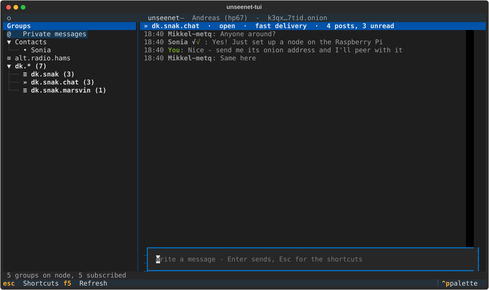

A group's owner can mark it as a chat, so it opens that way for
everybody, and can choose **fast delivery** (shown in the title). Nodes then
pass its messages on immediately instead of waiting a random time. That
makes the chat quick across nodes, but gives up some of the protection
of *where* a message was posted from - fine for friends chatting, less
so for sensitive discussions. Closed groups stay end-to-end encrypted
either way.

New posts arrive by **push**: the client keeps a second connection to
the node, which tells it about new messages as soon as they arrive. On
the same node a chat is practically instant.

## Feeds, people and the timeline

A **feed** shows entries newest first, with comments under each - a person's own feed, or
a group shown as one. Times say how long ago. A long entry is cut with *… more* (where
its author put a line of three dots, if they did); Enter shows it whole. A long comment
is cut shorter, with *… [more]*, its own words first; Enter shows it whole too. Comments are
folded to the newest one and your own talks: Enter on *View N more* shows 20 more, and
++ctrl+p++ *Which comments* shows where you wrote, or what names you, instead.

Follow a person from their profile, or ++ctrl+p++ *Follow*. Their feed and site come
under **People you follow**, by name, together.

The **Timeline** shows the entries of the feeds you follow, newest first and nothing
reordered. ++ctrl+p++ *Add to timeline / take out of timeline* puts a discussion group in
(each new thread, with its answers under it) or takes a feed out; `•` marks the groups in
it. Chat groups are never in it.

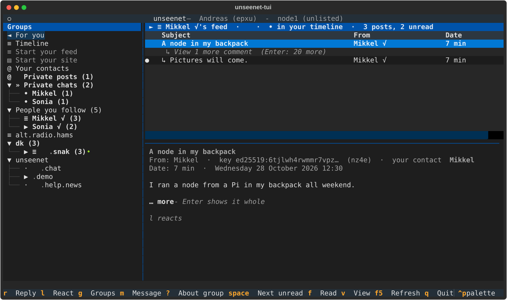

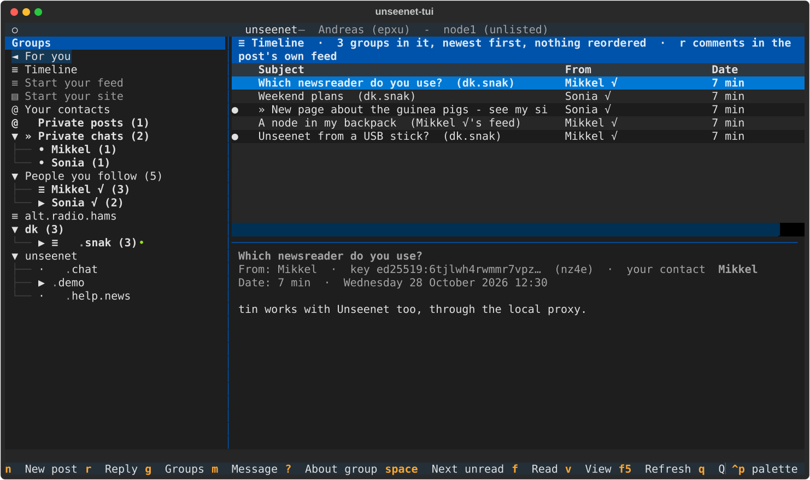

## Sharing

Pass on what you read, as on Facebook, Mastodon and X (UN-RFC 0060). In a feed, ++b++
shares the selected entry into your own feed (start it first: ++ctrl+p++ *Start your
feed*). ++ctrl+p++ has the rest:

- *Share with a comment* - your words, with the post as a card under them;
- *Share into a group* - bring it to up to three other groups besides your feed; a
  discussion group needs a few words that say why;
- *Send to* - to one person, privately; nobody else is told;
- *Undo share* - take back your share; sharing again replaces your earlier one there;
- *Open the shared post* - the original, where it was posted, to comment or react.

A share is a reference, never a copy. A plain share is listed as `↻ Mette shared:` and the
original's subject, and read as the original itself, as its author wrote it - fetched
through your nodes (*Fetching the shared post …* while it comes). A share with a comment
has the original framed under it, `┌ ↻ Andreas · dk.snak`, and says *edited after it was
shared* when the author changed it since. When the author withdraws the post it is gone
from every share. In the timeline each post comes once, `↻ shared by Søren and Mette` -
only people you follow are named, and nothing is ever counted.

Not offered on closed groups or private posts; where the author asked that a post not
be shared, Share says so - a request, not a protection, since anyone who reads a post can
copy it. ++ctrl+p++ *Hide shares here* or *Hide shares in feeds and the timeline* hides
plain shares; posts with words of their own still show. When someone shares a post of
yours you are told in For you (++ctrl+p++ *Stop showing share notices*).

## A group's charter

A group's owner can write its **charter**: what the group is for and what
it asks of those who write there. It is part of the group's signed
settings, so everyone sees the same charter and only the owner can change
it. The client shows it the first time you open the group, and again
whenever the owner changes it. Press ++question-mark++ to read it at any
time; "? charter" in the title means the group has one.

A charter is not enforced by any machine - moderators and the owner act
on it. That is the difference from [your own rules](https://unseenet.org/guide/rules/), which
are yours alone and which the client does apply to what you see.

Owners change the title, description, charter, view and delivery with
**Edit group** in the command palette (or the button in the ++question-mark++
window). Every node gets the new version. **Help** (or F1) in Edit group says,
for each setting, what it does, whom it affects and what changing it later
does - the same words as in the graphical client.

An open, moderated or channel group can have **its own emoji**, up to 16 small
pictures with a name: **The group's emoji** in the command palette lets the
owner add one from a picture file (it is made 32 by 32 and saved again without
metadata), rename, describe or remove them. Write `:marsvin:` in the group, and
graphical clients show its picture; this client shows `:marsvin:` as written.
The pictures are public, and only nodes that turn them on carry them
([UN-RFC 0056](https://unseenet.org/spec/un-rfc-0056/)).

A charter can be [Markdown](#formatting-markdown-and-emoji) - tick *Markdown*
under the text - so it can have headings such as "Welcome" and
"Not welcome", numbered lists and links. Pictures are not possible in
a charter: it lives in the group's signed settings, which cannot carry
attachments. Older clients show a Markdown charter as the text you typed,
which reads fine too ([UN-RFC 0014](https://unseenet.org/spec/un-rfc-0014/) section 2.1).

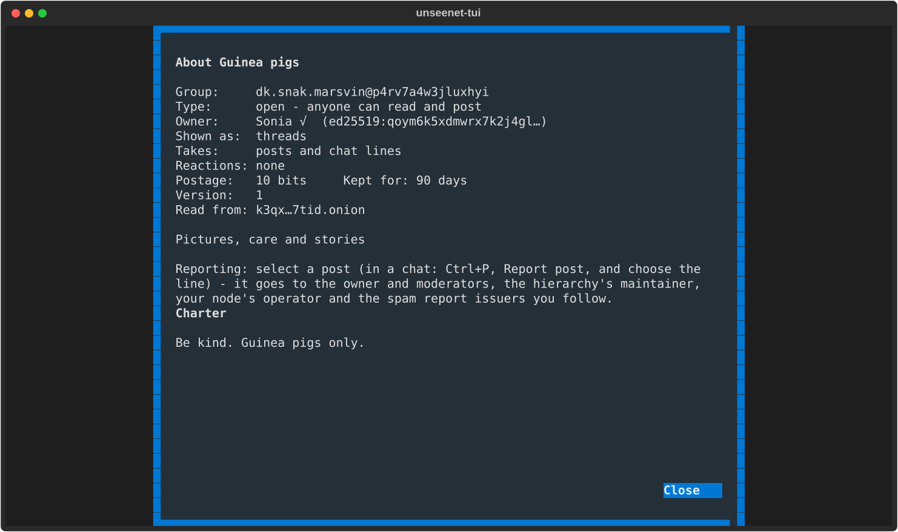

## Leaving and removing groups

In the command palette (++ctrl+p++):

- **Unsubscribe from group** stops following a group and deletes its saved
  posts from your computer. The group stays on the network.
- **Remove group from the network** is for groups **you own**: every node
  deletes the group and its posts, and the name can never be used again -
  not even by you. Use it for a typo in a name or a group nobody uses.
  Copies people have already saved cannot be deleted.

If the owner removes a group you follow, the client tells you, and you
can unsubscribe.

From the [command line client](#the-command-line-client) you can see which
groups your identities own, and remove several at once:

```bash
unseenet groups --mine
unseenet group-remove dk.test@42e5qnhtj53o27ww --reason "Typo in the name"
```

A group belongs to the identity whose key created it: the part after `@`
in the group ID is that key's fingerprint. `group-remove` finds the right
identity in your vault itself, and refuses groups none of them own and your
personal inbox. It asks you to type `remove` before anything is sent; in a
script, add `--yes`. Give the full group ID, not the short form the lists
show.

If you have lost the identity that owns a group, the group cannot be removed
from the network. A node operator can still
[drop it from their own node](https://unseenet.org/node/operations/#dropping-a-group).

## Banning someone from your group

If you own a group, select a post by the person and choose **Ban from
group** in the command palette, with a short reason. Nodes then refuse
their new posts in the group, and clients hide their old ones
([UN-RFC 0004](https://unseenet.org/spec/un-rfc-0004/) section 5.1). **Banned from group**
lists the bans and lifts one.

A ban is part of the group's signed settings, so it is **public**: anyone
can see in the group's settings (++question-mark++) that someone is banned
and why. It stops an identity, not a person - keys are free, so someone
determined can come back with a new one. Raise the group's postage to make
that slower, and withdraw posts you do not want (see below).

## Blocked in a hierarchy

A hierarchy can have a **maintainer** - for example an organisation that
runs `dk.*` ([how it works](https://unseenet.org/guide/groups/#names-and-hierarchies)). A maintainer can block
someone in its whole hierarchy, with a public reason - say a person who
posts threats in group after group. A maintainer it has given a part of
the hierarchy to, such as `dk.snak.*`, can block within that part.

Your client hides posts by blocked people and says so in the group's
title line ("2 hidden: blocked in dk.*: threats against members"). You
decide: **Show posts blocked by maintainers** in the command palette
shows them again. Node operators decide for their nodes, too
([`honour_blocks`](https://unseenet.org/node/configuration/#honour_blocks-maintainers-blocks)).

If you are a maintainer, select a post and choose **Block in hierarchy**,
with a reason. Your client adds the block to your hierarchy list and
posts it ([UN-RFC 0018](https://unseenet.org/spec/un-rfc-0018/) section 5.4). A block does
not delete anything and gives you no power over the groups themselves;
for real crimes, contact the police.

## Reporting a post

If a post goes against the group's charter or the law - spam, threats, abuse - select
it and choose **Report post** in the command palette (in a chat, where no line
is selected, it lets you choose the line). The report window shows the post;
choose what is wrong, tick who should get it - the group's owner and
moderators, the maintainer of its hierarchy, the operator of the node you read
it from, and the spam report issuers that apply to the group - write what you
want them to know (Markdown), and give paths to screenshots or PDFs. They are
sent encrypted, each receiver gets a sealed copy, and that takes a minute or
two of postage each; the status line says when it is done. A report can be
anonymous; then nobody can answer you.

How spam and reports work, and why nobody gets power over anyone by them, is in
the guide: [Spam and reports](https://unseenet.org/guide/spam/).

In an emergency, contact the police. Nobody on Unseenet - not the node
operators, not the project - can see who anyone is.

### Posts hidden by reports

Your client hides what the spam report issuers you follow report - never
silently. The list says **⊘ Hidden by reports@unseenet: spam** in the post's
place, the reader says the same, and the group's title says how many are
hidden. **Show anyway** in the command palette shows the selected one;
**Stop following this report issuer** stops that issuer hiding anything for
you. Your own posts and your contacts' are never hidden.

**Spam reports** in the palette lists the issuers that hide posts for you, and
where each is named - by a hierarchy (*named for unseenet.\**), by a group's
owner (*named for alt.space.nasa*) or by you. Untick one to turn it off, or
paste a key to follow another in every group.

### When a report reaches you

A report is a private post - in **Private posts**, or in a team inbox you read
(below). The reader says what you can do: **Open reported post** goes to the
post it is about; if you are an issuer, or an issuer is beside you in your
vault, **Publish a spam report** publishes it - also its author's key, for up
to a year - with the reporter's reason. What you publish is public and signed
by the issuer; the person who told you is never named in it. Otherwise act as
far as your role reaches: withdraw the post or ban its author in your group,
block them in your hierarchy, or drop the group from your node.

### Becoming an issuer

**Become a spam report issuer** in the palette: say what you report and how,
and where reports sent to you land - your own inbox, or a team inbox you read.
For an organisation, make the issuer a separate identity: `unseenet id-new
reports --display "Example spam reports"` beside yours, then **Become a spam
report issuer** acting as it (`-i reports` on the command line). To share it
with a colleague, **Copy to another device** with only that identity ticked;
their client finds by itself that it is an issuer.

For a group you own, **Edit group** has *Spam reports here*: the keys of the
issuers your readers follow there by default, separated by spaces.

### Team inboxes

The post that adds you as a reader of a team inbox says *Ctrl+P: Read this
inbox with the team*. The inbox is then listed under its name, and `r` there
answers as the team - *Reply as Unseenet (operator)* - without your signature.
If the owner removes you, the title says so; **Forget this team inbox** removes
its key. As the owner of an inbox, **Who reads this inbox** adds readers by
their key, removes them, and sets the name replies go out as.

## Tags and content warnings

Authors tag their own posts, and labellers you choose can label them
([how it works](https://unseenet.org/guide/spam/)). A **warning** - spoiler,
profanity, sexual, nudity, violence, gore - is shown as `▌spoiler` in its own colour,
before the subject in the list and over it in the reader, with who set it. A post you
chose to blur says *Ctrl+P: Show anyway* in place of its text; one you chose to hide
is a quiet line, `⊘ Hidden: gore, from …`. Nothing is covered silently, and your own
posts and your contacts' never are. Choose per warning, and see the labellers, with
**Content warnings and labels** in the command palette.

The **Language** field says what you write in - suggested from what you used last
in the group, or the group's own - and is remembered per group. When you write, put tags in the **Tags** field - a warning such as `spoiler`, or your
own words - or write `#word` in the text. A group's owner gives a group tags in
**Edit group**. Press `t` on a post to see everything with its tag in your groups and
feeds (or **Everything with a tag** in the palette).

## Ignoring someone

Select a post by the person and choose **Ignore this person** in the
command palette (++ctrl+p++). Their posts and private messages are hidden
from you in every group, like a killfile in the old newsreaders. Replies
to them by others stay, so a discussion does not lose its middle.

Only you know: the list is kept in your vault and never sent anywhere,
and the person is not told. **People you ignore** in the command palette
shows the list, and shows someone again.

## Pinned posts

The owner and moderators of a group can pin posts at the top of it, for
example a welcome post or the charter ([UN-RFC 0033](https://unseenet.org/spec/un-rfc-0033/)).
Nodes keep a pinned post beyond the group's window until it is unpinned.

In the threads view, the pins are in a **Pinned** section above the
threads, newest pin first, with their notes. A pinned post is also marked
`[P]` in its place. Press ++enter++ on the section's head to fold it away
or open it again; the client remembers this per group. In the chat view, a
line above the chat shows the newest pin, and **Next pin** in the command
palette shows the next. Pinned lines are marked `[P]` in the chat.
**Pinned posts** lists them all, and choosing one opens it.

To pin, select a post and choose **Pin or unpin post** in the command
palette (++ctrl+p++). In a chat, you choose the line from a list. You can
add a note that is shown with the pin. A group shows at most its
`max_pins` pins (5 unless its owner set another number): when it is full,
the client tells you which pin stops counting. Choosing the command on a
pinned post unpins it. A post older than the group keeps posts disappears
from the nodes as soon as it is unpinned, and the client says so first.
Pinning is not on a key, on purpose: it is rare.

Only pins by the owner and moderators of the group's current manifest
count, and your client checks this itself, as it does for withdrawals.

## Withdrawing a post

Select a post and choose **Withdraw post** in the command palette
(++ctrl+p++), or press ++shift+d++. You can withdraw your own posts, and
any post in a group you own or moderate. The client sends a signed
*cancel* ([UN-RFC 0004](https://unseenet.org/spec/un-rfc-0004/) section 7): nodes delete the
post and stop passing it on, and other clients stop showing it.

It is **withdrawn, not deleted**. People who have already read it may
have kept a copy, and nodes or programs that ignore the protocol can keep
it too. Think before you post.

Your client checks every cancel it receives itself: only the post's
author, or the group's owner or a moderator, can withdraw a post, so a
node cannot hide other people's posts from you. A cancel that arrives
before the post it withdraws is remembered, so the post is not shown when
it turns up later. In a closed group a cancel cannot carry a reason, since
the nodes could read it.

## Formatting: Markdown and emoji

What you write is **Markdown** ([UN-RFC 0031](https://unseenet.org/spec/un-rfc-0031/)): the
plain text Usenet always used, now also shown formatted. It reads fine
unformatted too, so readers like tin see it as you wrote it.

| You write | You get |
|-----------|---------|
| `*emphasis*`, `**strong**`, `~~struck~~` | *emphasis*, **strong**, ~~struck~~ |
| `` `code` `` and three backticks around a block | code |
| `# Heading`, `- list`, `1. list`, `> quote` | headings, lists and quotes (posts only, not chat) |
| `[text](http://...onion/)` | a link that also shows where it goes |
| `:tada:` `:+1:` or 🎉 👍 | emoji |

- Chat lines take emphasis, code, links and emoji, but not headings,
  lists or quotes, so chat stays chat.
- **Nothing is ever loaded from outside**: no web images, no previews.
  Images can only be attachments in the network itself; anything else
  shows as its description.
- Links show their real address; the graphical client warns before opening one
  that is not a `.onion` address.
- Shortcodes are GitHub's, Slack's and Discord's names (gemoji). On a
  terminal without emoji glyphs (the bootable image's console) they show
  as the shortcode.
- Rather send plain text? ++ctrl+p++, *Write plain text*. Your posts are
  then shown exactly as typed.

## Signature

A new identity starts with the signature `{name}  ·  {key}`, so others
can find your key. Press ++s++ to change it, or empty it for none. It is added at the bottom of the compose
window below a `-- ` line - the old Usenet signature separator - so you
can see it and change it before sending. Use up to four lines;
`{name}`, `{key}` and `{fp}` are filled in with your display name, your
key and its short fingerprint, e.g.:

```text
{name}  ·  {key}
```

When you reply, the other person's signature is left out of the quote,
and signatures are shown dimmed when you read.

## Reading on the whole screen

Press ++enter++ on a post (or click it a second time) to read it on the
whole screen. There, ++r++ replies, ++m++ writes privately to the author,
++n++ and ++p++ go to the next and previous post, ++space++ pages down and
then goes on to the next post, as in the old newsreaders, `#` goes to a
group the post names, and ++escape++ goes back to the list.

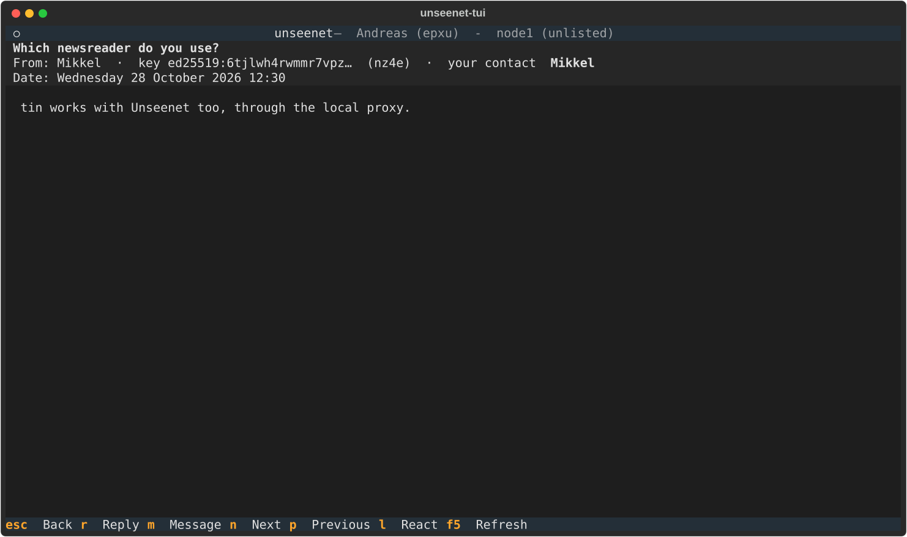

A post with files lists them under its text: the name, what kind of file
it is, its size and the description the author wrote. The terminal does
not draw the pictures; ++f++ saves the files in your Downloads folder (or
your home folder). They are checked against what the post names first,
and they are not opened: a program outside Unseenet may go to the
internet without Tor.

Writing a post or a reply (++n++, ++r++) opens the compose window, with your
signature below the `-- ` line. ++ctrl+s++ sends.


## Private messages

Every identity has a personal **inbox**. The client creates it on the
node the first time you connect. A private message is one of two kinds
([UN-RFC 0028](https://unseenet.org/spec/un-rfc-0028/)), and you choose which when you write:

- a **post** has a subject, is read on its own and answered with a
  quote, just like a post in a group. Private posts are near the top of the group list as
  *@ Private posts*, threaded, with the ones you sent among them (*You → name*).
- a **chat** is a line in a running conversation, without a subject.
  *» Private chats* holds them, one conversation per person: your contacts (`•`), and
  anyone else you have chatted with (`◦`, with the name they gave and their fingerprint),
  so a chat never goes missing and both sides of it stay together. Under it only the
  chats with unread lines show (at most three); select *Private chats* for all of them.

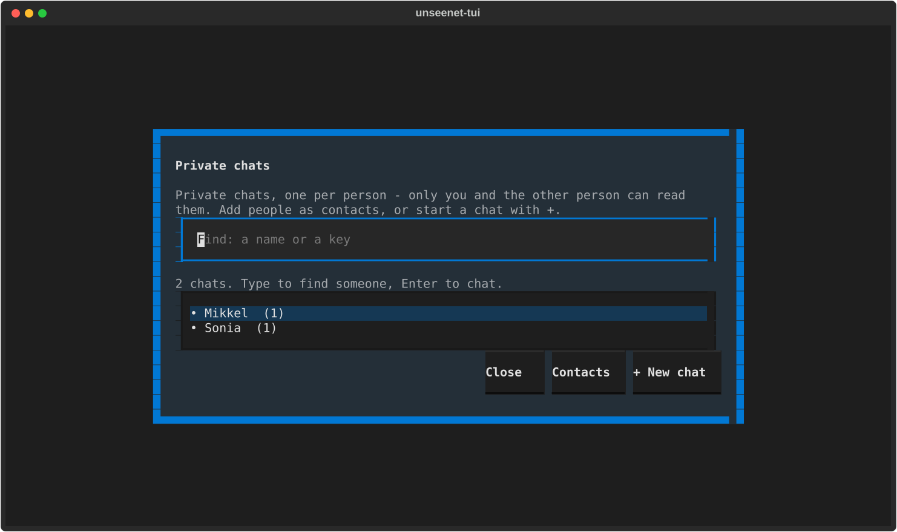

Only the recipient can see which kind a message is: the kind is inside
the sealed message. The copy on the node is sealed to the recipient, so
the client keeps its own copy of what you sent, encrypted in your vault.

- To write a private post, press ++m++; to chat, ++ctrl+p++ *Chat with someone*. Both open
  the **person picker**: recent people first, then your contacts - type to find someone, or
  paste a key (they find it with ++k++). ++tab++ switches between a chat and a post. If you
  have a post by someone selected, they are at the top.
  In a chat, ++n++ writes a post to them instead.
- Only the recipient can read the message. The node cannot, and it does
  not even learn who sent it: the message is sealed to the recipient's key
  and signed with a key that is used only once.
- Inside the sealed message you prove who you are, so the recipient sees
  your name marked **verified**.
- Press ++r++ on a private message to reply privately.

The recipient's inbox has to be on the node you use, or on a node it is
replicated to.

The node carries everyone's inbox as a group named `inbox@<fingerprint>`.
They are not shown when you browse groups (++g++): only the owner can read
an inbox, and you write to someone with ++m++ instead.

## Contacts and conversations

Press ++a++ on a post or a private message to add its author as a
**contact**, under a name you choose. *Your contacts* at the top of the group list (or
++c++) lists them, the names only you see; Enter chats with one. A chat shows both
directions, in order. ++n++ there writes them a post instead.

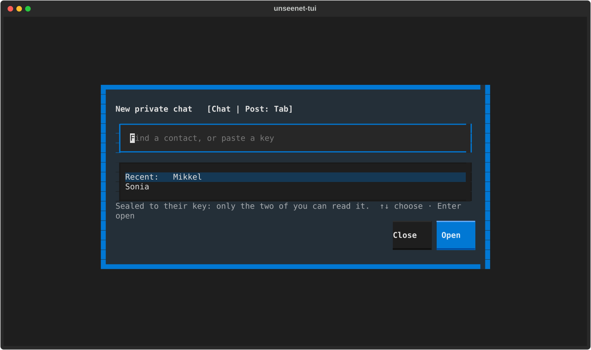

- The name is yours alone and is tied to the person's key. Someone else
  can call themselves "Sonia", but only the real one shows as
  **Sonia √** in your client - everywhere, also in public groups.
- Messages you send are sealed to the recipient, so not even you could
  read them on the node afterwards. The client keeps its own copy in your
  vault, so the vault file alone carries everything you need - in the
  terminal client, the graphical client and on the web.
- Rename or remove contacts from the command palette (++ctrl+p++).

## Your profile

You can publish a short public profile: a few lines about yourself, the
languages you write and links to your other accounts. With *Markdown*
ticked, the lines about you can be a small home page: headings, lists,
**strong** text, quotes, links and emoji, up to 2048 characters - but no
pictures (your picture has its own place). Ctrl+P → **Your
profile** writes, changes or removes it; links go one per line, as
`kind address`, for example `github andlo` or
`mastodon @andlo@fosstodon.org`.

Think before you do: anybody who sees your posts can read it, a link
ties this identity to that account, and copies others have kept cannot
be taken back. The client says so before your first profile. If you want
to stay unknown, keep a separate identity without a profile.

Ctrl+P → **Profile of this author** shows the profile of whoever wrote
the selected post, with their *identicon* - a small pattern made from
their key, the same in every client - and lets you hide a profile.
Links are shown exactly as written and never opened for you; they are
what the identity says, not something anybody checked.

Your profile is renewed along with your inbox, so it stays as long as
you use the identity ([UN-RFC 0022](https://unseenet.org/spec/un-rfc-0022/),
[0029](https://unseenet.org/spec/un-rfc-0029/)).

## Names

Group names and people's names are shown as short as is safe
([UN-RFC 0018](https://unseenet.org/spec/un-rfc-0018/) and [0019](https://unseenet.org/spec/un-rfc-0019/)).
The client reads the project's lists for this in the background, like the
node list, and keeps them in your vault.

- **Groups** are shown without their fingerprint when the name cannot be
  mistaken: `unseenet.announce` is the one the project vouches for; a
  group someone else made with the same name shows as
  `unseenet.announce@k2xq`, and the list of all groups (++g++) warns about
  it. In hierarchies nobody looks after, like `dk` or `alt`, the short
  name is shown while you know of only one group by that name.
- **People** are shown by your own name for them (**Sonia √**), else by
  a name they hold (`@lorensen.dk`, `@lorensen`), else as the name they
  chose with the start of their fingerprint: `Andreas~2byg`. Anyone can
  call themselves "Andreas"; only a name with `@` or `√` is checked.

### Claiming a name

Press `@`, type the name and press ++enter++ (or *Claim*).

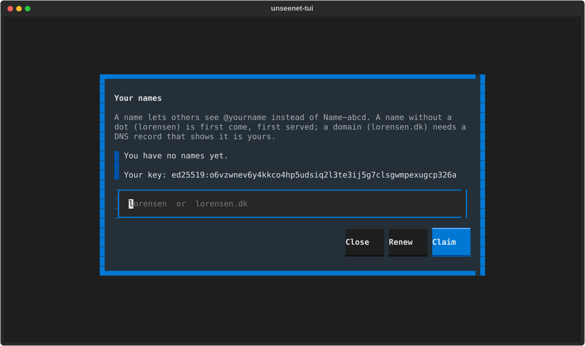

- A name **without a dot**, like `lorensen`, is first come, first served.
  Names that are Internet top-level domains (`dk`, `microsoft`) cannot be
  had.
- A **domain**, like `lorensen.dk`, shows that the domain is yours. The
  client tells you the DNS record to add first, a TXT record with your key.
  Keep the record: the name is renewed each month while it is there.

The claim is sent sealed to the registrar, which decides after about an
hour. Its answer comes to your private messages, and the name then shows
under `@`. Registered names last a year; renew them under `@` with
*Renew*. Your posts in public groups carry your name about once a week
per group, so others can check it; posts in closed groups and private
messages never do. A name links everything its identity posts, so do not
claim one for an identity you keep apart.

### Names under a name

If you hold a name such as `@lorensen`, you can give names under it:
`andreas@lorensen` for yourself, `sonia@lorensen` for your daughter -
like e-mail addresses in a family or an organisation. No registrar is
involved; your key signs it.

- **Give a name under yours** (command palette): the name, whose key
  (filled in from the selected post) and for how many years (1 to 5).
  Your client renews it when it is about to run out.
- **Ask for a name under someone's name**: type e.g. `sonia@lorensen`;
  its holder gets your request under **Name requests** and gives it or
  refuses. The name arrives in your private messages and shows on your
  posts from then on.
- **Names you gave** lists them and takes one back. Taking back is
  public: it goes in your list of revoked names.
- **Name your posts show**: with several names (your own `@jaxie`,
  `sonia@lorensen`, ...), choose the one readers see.

A name under yours counts only while `@lorensen` is yours: if you give it
up or it runs out, the names under it stop counting too.

A domain can name people in DNS, as for e-mail: with the record
`andlo._unseenet.lorensen.dk TXT "unseenet-key=ed25519:..."` you claim
`andlo@lorensen.dk` under `@` like any name, and the registrar checks the
record every month. An organisation can name its people this way without
running Unseenet itself.

Under `@` you can also give a name up or hand it on. Type the name, then:

- **Transfer** gives it to another key - your new identity's when you
  move to a new key, or someone else's. Paste their key; your own key
  loses the name.
- **Release** gives it up at once, and anyone can claim it after that.

Both go to the registrar like a claim, and the answer comes to your
private messages.

## Several nodes

Your key lives in your vault, not on a node, so you are the same person
on every node you use: the same name, the same √ for your contacts, and
the groups you own are yours everywhere. One node may carry some groups
and another node others, so the client can use several at once.

Press ++o++ for **Your nodes**:

- **Add** a node by its address (`xxxx.onion`, or `xxxx.onion:port`).
  Its groups show up when you browse with ++g++, marked with the node they
  are on.
- **Make default**: new groups and your personal inbox go to the default
  node (♦). The others are only read from and posted to.
- **Remove** stops using a node. Groups you read from it move to your
  default node; nothing is deleted on the node itself.
- **Details** shows who runs the node and lets you write to the operator.

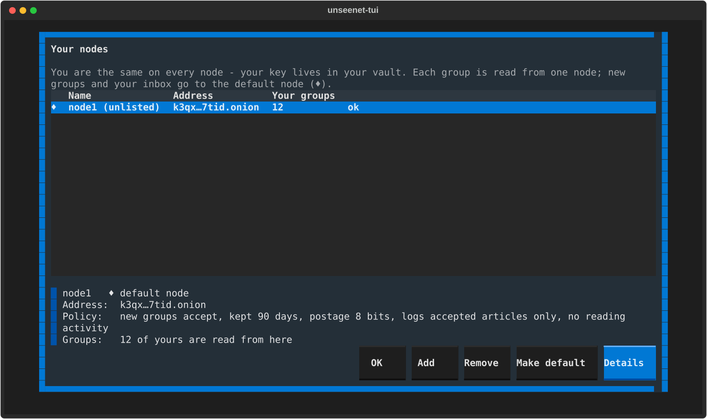

Each group is read from one node, shown as *Read from* when you press
++question-mark++. If that node stops carrying a group, or cannot be reached,
the client reads it from another of your nodes that does. An
`unseenet:` address can name the group's node (`n=`); if you do not use it
yet, the client offers to add it.

Using the same key on several nodes lets those nodes see that it is the
same person. If you want to keep two parts of your life apart, use two
identities.

## Known nodes and announcements

The client knows a list of nodes to start with, so you can pick one instead
of typing an address. Once connected, it reads the newest list from the
project's channel `unseenet.nodes@ph5fc5hop5232qsz`
([UN-RFC 0010](https://unseenet.org/spec/un-rfc-0010/)): through the node you already use, over
Tor, and only if it is signed by the project. Nothing is fetched from a web
site. **Add** in "Your nodes" (++o++) offers the nodes from that list that
you do not use yet.

New versions and important news are posted to
`unseenet.announce@ph5fc5hop5232qsz`. Join it with ++j++ to hear about them.
It is a channel: only the project can post there.

## Contacting a node's operator

Press ++o++, choose a node and **Details** to see who runs it and its policy: which groups it
accepts, how long it keeps posts, the minimum postage and what it logs.
If the operator has set up a contact inbox, **Write to operator** sends
them a private message. Use it to report abuse, ask for a group to be
carried, or just say thanks.

## Addresses

Every group, post and person has an `unseenet:` address
([UN-RFC 0031](https://unseenet.org/spec/un-rfc-0031/) section 3.4.1) to give to others:
`unseenet:dk.snak@abcd...` for a group, `?m=` added for a post, and
`unseenet:` with a fingerprint for a person. In the command palette
(++ctrl+p++), **Address of this post** and **Address of this group** show
one, and copy it where the terminal allows. Paste one after ++j++ to open
it: a group you do not follow yet is joined, a post is selected in its
group, and a person's profile opens if the client has met their key. The
older forms (`unseenet:join?g=...`) work too.

## Joining a closed group

Closed groups are end-to-end encrypted, so you need to be invited:

1. Press ++k++ and send your key to the group's owner (any way you like).
2. The owner selects the group, opens the command palette (++ctrl+p++), chooses **Invite to closed group** and pastes your key.
3. The owner sends you the `unseenet:<group-id>?n=...` address it shows.
4. You press ++j++ and paste the address.

A minute or so later, when the invitation has reached your node, the
posts become readable.

## Running your group: moderators, posters and members

As a group's owner you choose who else has a role, in the command palette
(++ctrl+p++). Select a post by the person first, and their key is filled in.

- **Make moderator**: moderators post directly in a moderated group,
  approve others' posts, and can withdraw any post in the group.
- **Make poster** (channels): posters may post in your channel.
- **Edit group** (channels): *Readers may comment on posts* lets anyone
  reply to a post in your channel, optionally only for a number of days
  after it was posted. New threads are still yours and your posters'.
- **Moderators and posters** lists them and removes one.
- **Members of closed group** lists the people you invited from this
  client, and **removes** one. The group then gets a new key, sent to
  everyone else; the removed member cannot read or post anything new,
  but keeps what they have already read. Posts others wrote with the old
  key in the same moment may be refused; the client says so, and you can
  send them again. Members you invited from another device
  (or before version 0.3.0) are not on the list and do not get the new
  key either - invite them again.

*About group* (++question-mark++) shows everyone the moderators and posters.

### Moderated groups

In a **moderated** group, a post by someone who is not a moderator is
not posted straight away. The client sends it, sealed, to the owner and
every moderator ([UN-RFC 0009](https://unseenet.org/spec/un-rfc-0009/) section 3), and tells
you it is waiting for approval.

Moderators open **Moderation queue** in the command palette. *Approve*
posts it unchanged - the author's signature and Message-ID stay - and
*Reject* drops it. The first moderator to act decides; the others' queues
forget it.

## Sending takes a moment

Every post carries a small proof-of-work, about a second of CPU time. It
makes mass spam expensive. The client computes it in the background.

## Your vault

- Everything you store is in the vault file, encrypted with your
  passphrase (Argon2id + XSalsa20-Poly1305). It is only decrypted in memory.
- Back it up, or at least write down your **recovery words** (below). If
  you lose the vault and have neither, you lose your identity and your
  keys to closed groups.
- The vault and its cache are normal files, so they can live on a USB stick
  together with the program. A copy of the vault on another device is the
  same identity: it opens with the same passphrase and holds the same keys.
- **Change passphrase** in the command palette (Ctrl+P) gives the vault a
  new passphrase. Only that one file changes: copies of it on other devices,
  sticks or backups still open with the old passphrase. If you change it
  because the old one may be known, replace or delete those copies too.

## Recovery words

Your identity can be written down as 24 **recovery words**. With them you
get it back on any device - your groups, contacts and settings come back
from the network, where they are kept encrypted for you.

- When you create an identity the client shows the words. Write them on
  paper, then type three of them back as a check. You can do it later:
  the client reminds you, at most once a week. **Show recovery words** in
  the command palette (Ctrl+P) shows them again, after your passphrase.
- Whoever has the words *is* you. Keep the paper safe and away from the
  stick. **Save as file…** is there if you must, but never on the same
  stick or disk as the vault, and not in a cloud-synced folder; on the
  bootable client the words are only shown.
- **Closed groups do not come back** with the words. After a restore the
  client lists the closed groups you followed and can ask their owners to
  invite you again.
- To restore: at first start choose **Restore from recovery words**, or
  use the command palette. Four letters of each word are enough; a typing
  mistake is caught before anything happens.

These are Unseenet recovery words, not a cryptocurrency wallet phrase -
never type them into a wallet.

## Copying to another device

**Copy to another device** (Ctrl+P) puts your identities on a phone, PC
or another stick, straight over Tor - no file to carry around.

1. Choose which identities to copy, and whether the keys of your closed
   groups go too. Leave out an identity that must stay hidden: a phone is
   lost more often than a stick.
2. The client shows a QR code and a code such as `7-guitar-tunnel`. On
   the other device choose **Get identity from another device** (at first
   start, or in its palette) and scan or type it. The code works once,
   for 10 minutes.
3. Both devices show the same two **check words**. Only when you confirm
   here that they match is anything sent.

The copy is a copy: both devices have the identity afterwards. In the
terminal client you type the code; scanning needs a device with a camera.

## Reading offline

Posts you have fetched are kept in an encrypted cache next to the vault
(`unseenet.vault.cache`), encrypted with the same key. When you start the
client it shows them at once, and then fetches what is new. Without a
connection to the node you can still read everything you fetched before.

The cache belongs to one node: article numbers differ between nodes, so
if you switch node the cache starts over.

## The command line client

There is also a plain command line client for scripting and testing:

```bash
unseenet --help
```

| Command | What it does |
|---|---|
| `id-new NAME [--display NAME]` | Create an identity |
| `id-import NAME [--display NAME]` | Add an identity from its seed, 64 hex characters read from stdin (never the command line) |
| `whoami` | List your identities and their keys |
| `node-add ADDRESS` | Add a node (`xyz.onion` or `host:port`) |
| `groups [PATTERN] [--mine]` | List groups on the node; `--mine` only those your identities own |
| `group-create NAME [--type ...] [settings]` | Create a group you own: `--view feed\|pages\|chat`, `--poster KEY`, `--moderator KEY`, `--comments open`, `--attachments MAX_SIZE [--types image/*]`, `--max-pins`, `--max-pages`, `--home`, `--charter FILE` and more (`group-create --help`) |
| `group-edit GROUP_ID [changes]` | Change a group you own, in one new manifest: `--add-poster`/`--remove-poster`, `--add-moderator`/`--remove-moderator`, `--ban KEY [--reason TEXT]`/`--unban`, and every setting of `group-create` |
| `group-show GROUP_ID` | Show the group's current manifest |
| `group-remove GROUP_ID ... [--reason TEXT] [--yes]` | Remove groups you own from the whole network ([final](#leaving-and-removing-groups)) |
| `invite GROUP_ID KEY` | Give a key access to a closed group you own |
| `post GROUP_ID -s SUBJECT [--body TEXT]` | Post; the body is read from stdin without `--body` |
| `post GROUP_ID --reply-to MESSAGE_ID` | Reply, or comment in a channel; the subject is `Re:` the parent's unless you give one |
| `post GROUP_ID --kind chat --body TEXT` | A chat line instead of a post |
| `post GROUP_ID --edit MESSAGE_ID --body TEXT` | A new version of your own post |
| `post ... --attach FILE` | Post with up to four files, if the group takes them; pictures are saved again without their metadata (where and when they were taken, the camera) |
| `post ... --format markdown\|plain` | The text's format (default: your setting) |
| `pin GROUP_ID MESSAGE_ID [--note TEXT] [--unpin]` | Owner or moderator: pin a post at the top of the group, kept beyond its window |
| `pins GROUP_ID` | The posts pinned in a group |
| `page-put SITE_ID PATH FILE [--title TEXT]` | Write a page of a site you write in, from a Markdown file; a new version replaces the old one, which is kept as the previous version. Pictures: write `` in the page, and the file is cleaned of metadata, sent with it and pointed at |
| `page-remove SITE_ID PATH` | Remove a page from a site |
| `pages SITE_ID` | A site's pages, the home page first |
| `feed-start [--comments open\|none] [--yes]` | Start your personal feed - public and tied to your key, so you are told first |
| `site-start [--yes]` | Start your personal site, the same way |
| `profile [--about TEXT] [--link KIND=VALUE] [--lang TAG] [--feed GROUP_ID] [--picture FILE]` | Show or publish your public profile; a picture is cut square, made small and cleaned of metadata. `--of WHO` shows someone else's |
| `follow TARGET` | Follow a feed (its Group ID or address) or a person (a key, fingerprint, `unseenet:` address or name): their feeds, now and as they change. Nobody is told |
| `unfollow TARGET` | Stop following; the feeds followed only because of a person go too |
| `following [--refresh]` | Whom and what you follow |
| `timeline [--limit N]` | The entries of every feed you follow, newest first, as written |
| `address [GROUP_ID [--message ID \| --page PATH]]` | The `unseenet:` address of a group, a post or a page - or, alone, yours |
| `open ADDRESS [--follow]` | What an `unseenet:` address names |
| `read GROUP_ID` | Read a group, with each post's Message-ID (`--json`: author, date, references, kind, page and files of each) |
| `withdraw GROUP_ID MESSAGE_ID ... [--yes]` | [Withdraw posts](#withdrawing-a-post): your own, or any in a group you own or moderate |
| `withdraw GROUP_ID --all [--keep MESSAGE_ID] [--keep-author KEY]` | Withdraw every post in a group you own or moderate, but those you keep |
| `bridges [MODE]` | Show or set [Tor bridges](https://unseenet.org/tor/) |

Global options go before the command: `--vault FILE` picks the vault and
`--identity NAME` the identity for this command (default: the first), and
`--json` answers in JSON, for scripts. The passphrase is read from
`UNSEENET_PASSPHRASE` if it is set, otherwise you are asked.
